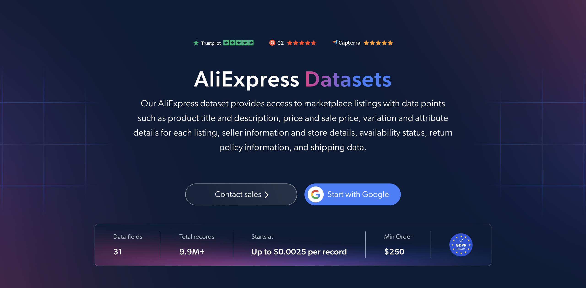

# Aliexpress-dataset-sample

<h2>A sample dataset of 1000 AliExpress products</h2>

<a href="https://brightdata.com/products/datasets/aliexpress">
   
</a>

An AliExpress dataset sample of 1000 products. Dataset was extracted using the <b>Bright Data API</b>.

<h2>Some of the data points that are included in the dataset:</h2>

* ```url```: URL of the AliExpress product page
* ```item_id```: Unique identifier for each product
* ```variant_id```: Unique identifier for each product variant
* ```title```: Title of the product
* ```description```: Full description of the product
* ```category_tree```: Category path of the product, with names and URLs
* ```brand```: Brand of the product
* ```image_url```: URL of the main product image
* ```price```: Regular price of the product
* ```sale_price```: Discounted price of the product
* ```availability```: Availability status, such as in stock, out of stock or pre-order
* ```variants```: All available variant options, grouped by type
* ```variant_attributes```: Attributes of the selected variant, such as color or size
* ```specifications```: Technical specifications of the product
* ```store_name```: Name of the store selling the product
* ```store_country```: Country of the store
* ```return_window```: Number of days allowed for returns
* ```star_rating```: Average review score on a 0-5 scale
* ```review_count```: Number of product reviews
* ```reviews```: Customer reviews of the product

And a lot more.

This is a sample subset which is derived from the "AliExpress Products (public data)"
dataset which includes more than <b>9,900,000 products</b>.

Available dataset file formats: <b>JSON, NDJSON, JSON Lines, CSV, XLSX, or Parquet. Optionally, files can be compressed to .gz</b>.

Dataset delivery type options: <b>Email, API download, Webhook, Amazon S3, Google Cloud storage, Google Cloud PubSub, Microsoft Azure, Snowflake, SFTP</b>.

Update frequency: <b>Once, Daily, Weekly, Monthly, Quarterly, Biannual, or Custom basis</b>.

Data enrichment available as an addition to the data points extracted: <b>Based on request.</b>

<b>[Get the full AliExpress dataset](https://brightdata.com/products/datasets/aliexpress)</b>.

<a href="https://brightdata.com/products/datasets/aliexpress">
</a>

<h2>What are the AliExpress datasets use cases?</h2>

<h3>1. Price and discount tracking</h3>
Businesses use AliExpress datasets to track regular and sale prices across products and variants. By comparing how deep discounts run in each category, companies can benchmark competitors and set their own pricing strategies.

<h3>2. Customer sentiment analysis</h3>
Brands analyze star ratings, review counts and review text to learn what buyers like or dislike about products and sellers. Tracking how sentiment shifts by category reveals quality issues and unmet needs that can guide product development.

<h3>3. Seller and supplier comparison</h3>
Retailers and sourcing teams compare the stores selling similar items by store country, return window and availability. This helps them choose reliable suppliers and understand the competition they face on the marketplace.

<h2>Free access to web scraping tools and datasets for academic researchers and NGOs</h2>

The Bright Initiative offers access to Bright Data's <b>[Web Scraper APIs](https://brightdata.com/products/web-scraper)</b> and <b>[ready-to-use datasets](https://brightdata.com/products/datasets)</b> to leading academic faculties and researchers, NGOs and NPOs promoting various environmental and social causes. You can submit an application <b>[here](https://brightinitiative.com)</b>.
